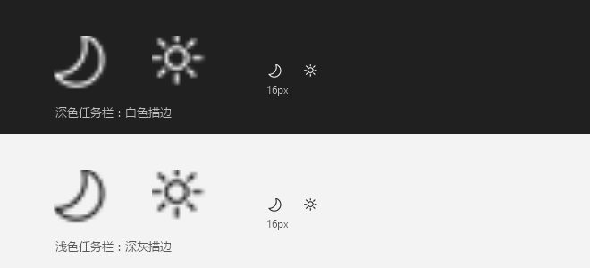

# Theme-toggle

[简体中文](README.md) | **English**

A lightweight Windows 10 / 11 tray utility for switching between custom light and dark presets. Configure system and app themes independently. Built with PowerShell and Windows components, with no additional dependencies to install.

A persistent sun / moon icon in the notification area lets you **switch between two custom presets with one click**, instead of navigating through Windows personalization settings.



## Quick start

1. Click **Code → Download ZIP** on the repository page and extract it, or run `git clone https://github.com/QUEQIAN1961/Theme-toggle.git`.
2. Double-click `Create-Shortcut.cmd` to generate `Start-ThemeTray.lnk` with the custom icon in the current folder.
3. Double-click `Start-ThemeTray.lnk` (or run `Start-ThemeTray.vbs` directly) and find the sun / moon icon in the notification area.
4. Left-click to switch themes. Right-click for the menu; after editing `settings.json`, choose “重新载入 settings.json” (Reload settings.json).

Requires Windows 10 / 11, Windows PowerShell 5.1, and Windows Script Host enabled. Administrator privileges are normally unnecessary. If Windows marks downloaded files as coming from the internet, verify the source, unblock the ZIP in its properties, and then extract it.

Shortcuts are generated for the current folder. Run `Create-Shortcut.cmd` again after moving it. Machine-specific `.lnk` files are excluded from the repository.

Chinese is the default documentation language. This English README explains the existing Chinese interface; switching documentation languages does not change the app's menu language.

## Define your two presets

Edit `settings.json` in the same folder (created automatically on first run if missing):

```json
{
  "sun": {
    "name": "浅色",
    "system": "dark",
    "apps": "light"
  },
  "moon": {
    "name": "深色",
    "system": "dark",
    "apps": "dark"
  }
}
```

- `sun` and `moon` identify the presets and their icons. Customize `name` to change the menu and tooltip labels; for example, use `Light` and `Dark`.
- `system` controls `SystemUsesLightTheme`: the taskbar, Start menu, and Action Center.
- `apps` controls `AppsUseLightTheme`: the Windows default app mode.
- Values accept `light` / `dark`, Chinese aliases (`浅色` / `深色` / `亮` / `暗`), or `true` / `false`.
- By default, **the system stays dark while only apps switch**: both presets use `system: dark`, while apps use `light` for sun and `dark` for moon. Set a preset's `system` to `light` if you also want the system theme to change.

After editing the file, right-click the icon and select **重新载入 settings.json** (Reload settings.json). No tray restart is needed.

## Files

| File | Purpose |
| --- | --- |
| `settings.json` | Your two theme presets |
| `ThemePresets.ps1` | Reads and validates presets; falls back to defaults for invalid JSON |
| `Toggle-Theme.ps1` | Applies registry values and broadcasts `WM_SETTINGCHANGE` |
| `ThemeTray.ps1` | Tray UI: left-click to toggle, right-click for the menu |
| `New-ThemeIcon.ps1` | Generates multi-size ICO icons from Segoe MDL2 glyphs |
| `Create-Shortcut.cmd` / `Create-Shortcut.ps1` | Generates a launch shortcut using the current folder and custom icon |
| `Start-ThemeTray.vbs` | Silent launcher without a console window |
| `Stop-ThemeTray.ps1` / `Stop-ThemeTray.vbs` | Stops the tray process |
| `theme-toggle.ico` | Shortcut icon with a diagonal sun / moon design |
| `New-ShortcutIcon.ps1` | Regenerates the shortcut icon |
| `preview.png` | Tray icon preview at different sizes on light and dark taskbars |
| `ico-preview.png` | Shortcut icon preview |

## Shortcut icon

`theme-toggle.ico` has a diagonal split from top-right to bottom-left, with the sun in the upper-left half and the moon in the lower-right half. It includes nine sizes: 16/20/24/32/40/48/64/128/256. Small sizes are rendered at 4× resolution and downsampled for smoother edges.

To create a shortcut that toggles the theme directly without keeping the tray running:

1. Right-click the desktop and choose **New → Shortcut**.
2. Enter the following location, replacing the script path with your actual path:

   ```text
   powershell.exe -NoProfile -ExecutionPolicy Bypass -WindowStyle Hidden -File "C:\path\to\Theme-toggle\Toggle-Theme.ps1"
   ```

3. Choose a name, such as “Toggle theme”.
4. Open the shortcut's **Properties → Shortcut → Change Icon**, then browse to `theme-toggle.ico`.
5. Optionally assign a shortcut key such as `Ctrl + Alt + D` in the same properties tab.

To customize the colors or line thickness, edit the four color variables and line-width factor near the top of `New-ShortcutIcon.ps1`, then run:

```powershell
powershell.exe -NoProfile -ExecutionPolicy Bypass -File .\New-ShortcutIcon.ps1 -Preview
```

## Usage

**Start:** double-click `Start-ThemeTray.vbs`. The icon appears in the notification area; it may be hidden under `^`, where you can drag it onto the taskbar.

- **Left-click:** switch to the other preset.
- **Right-click:** choose a light or dark preset (the current match is checked), reload `settings.json`, edit it in Notepad, or exit. The default preset names are “浅色” (Light) and “深色” (Dark).

**Command line:** toggle without keeping a tray process running, or use these commands in a shortcut or hotkey:

```powershell
powershell.exe -NoProfile -ExecutionPolicy Bypass -File .\Toggle-Theme.ps1              # Switch to the other preset
powershell.exe -NoProfile -ExecutionPolicy Bypass -File .\Toggle-Theme.ps1 -Preset sun   # Apply a specific preset
powershell.exe -NoProfile -ExecutionPolicy Bypass -File .\Toggle-Theme.ps1 -Status      # Show the current state
powershell.exe -NoProfile -ExecutionPolicy Bypass -File .\Toggle-Theme.ps1 -DryRun      # Preview values without writing them
```

Use `-DryRun` after editing `settings.json` to check the values before applying them.

**Start with Windows:** create a shortcut to `Start-ThemeTray.vbs` and place it in:

```text
%APPDATA%\Microsoft\Windows\Start Menu\Programs\Startup
```

## Stop the tray

1. Right-click the tray icon and select **退出** (Exit). Check the hidden icons under `^` if needed.
2. Or double-click `Stop-ThemeTray.vbs` to stop it silently. It uses `ThemeTray.pid` and checks the process start time to identify the tray process without stopping unrelated PowerShell processes.
3. Alternatively, use **Task Manager → Details → powershell.exe** and end the process whose command line contains `ThemeTray.ps1`.

Exiting the tray leaves the current theme settings in place. Double-click `Start-ThemeTray.vbs` to start it again.

## Implementation notes

- **Tray icons:** Segoe MDL2 Assets outline glyphs (`U+E706` sun / `U+E708` moon) in six sizes: 16/20/24/32/40/48. Sizes below 32px are rendered at 4× resolution and downsampled.
- **Icon contrast:** colors follow the taskbar theme: white on dark taskbars and dark gray on light ones, including when the system stays dark while apps use a light theme.
- **Preset matching:** both registry values must match a preset. If neither matches, the icon follows the app mode and the tooltip reports “未匹配预设” (No matching preset).
- **Repeated clicks:** clicks within 300ms are ignored. Timing uses `DateTime.Ticks`, because `Environment.TickCount64` is unavailable on .NET Framework.
- **Error handling:** callback errors are written to `ThemeTray.error.log` instead of showing a .NET crash dialog. The tray checks the actual theme state every two seconds.

## Known limitations

- Explorer, the taskbar, Start menu, and UWP apps usually follow the change immediately. Apps that cache their theme, such as browsers, VS Code, and terminals, may need a restart, as with changing the theme manually.
- If the taskbar occasionally fails to refresh, restart `explorer.exe`.
- Windows does not support adding a custom tile to the notification area's quick actions; this tool uses a tray icon instead.

## Recommended tray launch shortcut

Double-click `Create-Shortcut.cmd` to generate `Start-ThemeTray.lnk` in the current folder using `theme-toggle.ico`. Double-click the shortcut to launch the tray silently, or copy it to your desktop.

Keep the shortcut generator scripts and icon in the repository. `.lnk` files contain absolute local paths, so each user should generate their own after downloading. After moving the folder, generate the shortcut again and replace any desktop copy.
